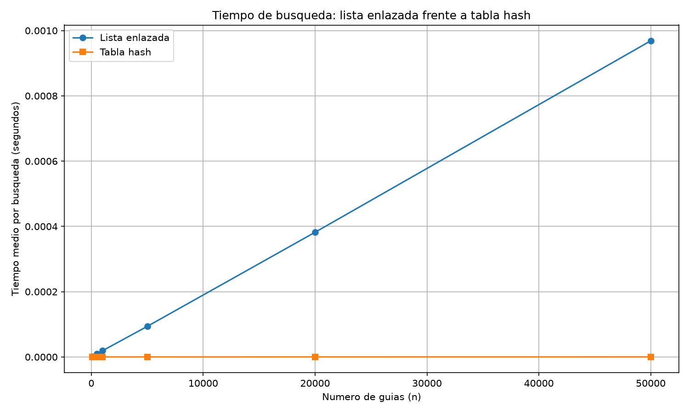
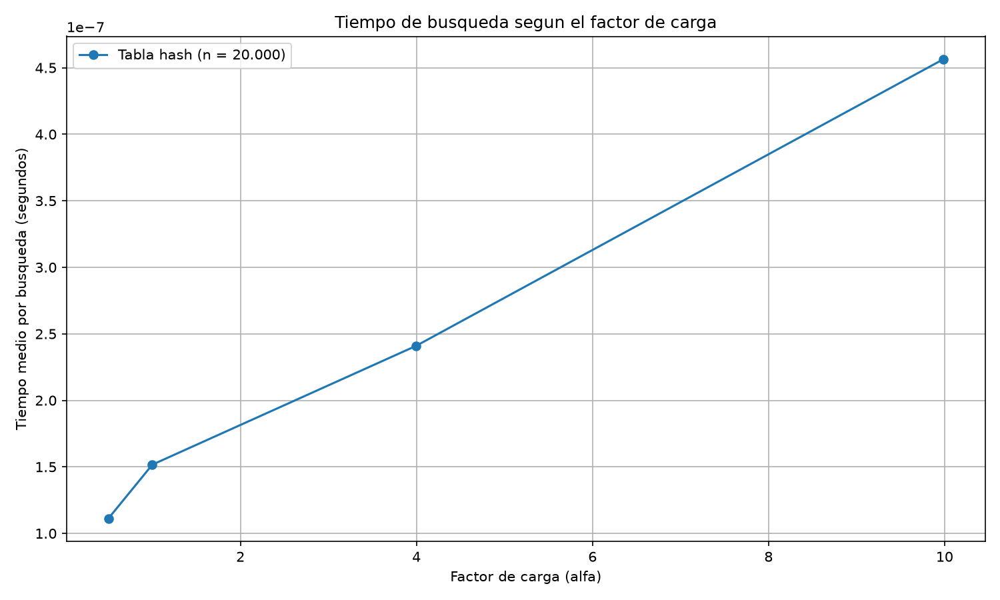

# Laboratorio 3 — Estructuras de datos

**Estudiante:** Carolina Arango Escobar

## Cómo ejecutar el laboratorio

Para ejecutar el laboratorio, primero se debe ubicar la carpeta principal del repositorio e instalar las dependencias necesarias.

### 1. Instalar las dependencias

Desde la carpeta principal del repositorio, ejecutar:

```bash
python -m pip install -r requirements.txt
```

### 2. Activar el entorno virtual

Según el sistema operativo, utilizar el comando correspondiente:

**Windows (CMD):**

```cmd
venv\Scripts\activate
```

**Windows (PowerShell):**

```powershell
venv\Scripts\Activate.ps1
```

**Linux o macOS:**

```bash
source venv/bin/activate
```

### 3. Ingresar a la carpeta del laboratorio

```bash
cd laboratorios/lab3-estructuras-datos
```

### 4. Ejecutar las pruebas

```bash
python pruebas.py
```

### 5. Ejecutar los experimentos

```bash
python medicion.py
```

Este archivo ejecuta los dos experimentos, muestra los tiempos de búsqueda y genera las gráficas dentro de la carpeta `graficas`.

---

## Parte 1. Implementación y pruebas de las estructuras de datos

Para esta parte se implementaron dos estructuras de datos: una lista enlazada y una tabla hash.

### Lista enlazada

Se implementó una lista enlazada para almacenar los números de guía y sus respectivos estados. Cada nodo contiene la información de una guía, su estado y una referencia al siguiente nodo.

Las operaciones principales permiten insertar elementos y buscar una guía dentro de la lista.

### Tabla hash

Se implementó una tabla hash utilizando el método de división para calcular la posición de almacenamiento de cada elemento. Para manejar las colisiones se utilizó encadenamiento, es decir, cada posición de la tabla puede almacenar una lista enlazada.

El factor de carga se calcula dividiendo la cantidad de elementos almacenados entre el tamaño de la tabla:

\[
\alpha = \frac{n}{m}
\]

Donde:

- \(n\): cantidad de elementos almacenados.
- \(m\): tamaño de la tabla.
- \(\alpha\): factor de carga.

### Pruebas realizadas

Se realizaron pruebas para verificar el funcionamiento de las dos estructuras:

- Inserción de elementos en la lista enlazada y en la tabla hash.
- Búsqueda de guías existentes.
- Búsqueda de guías que no se encuentran almacenadas.
- Comparación de los resultados de búsqueda entre las dos estructuras.
- Verificación del manejo de colisiones en la tabla hash.

Para comprobar el manejo de colisiones se insertaron las guías 10, 24 y 17 en una tabla de tamaño 7. Las tres guías quedaron ubicadas en la posición 3, por lo que se comprobó que el encadenamiento permite almacenar varios elementos en una misma posición.

En este caso, la longitud de la cadena fue de 3 y el factor de carga fue:

\[
\alpha = \frac{3}{7} \approx 0.4286
\]

También se realizaron pruebas con 20 colecciones aleatorias, verificando búsquedas exitosas y no exitosas.

---

## Parte 2. Medición y análisis del rendimiento

Para esta parte se realizaron experimentos con el objetivo de comparar el tiempo de búsqueda de una lista enlazada y una tabla hash, y observar cómo influye el factor de carga en el rendimiento de la tabla hash.

Las mediciones se realizaron utilizando `time.perf_counter()`. Se midió el tiempo de las búsquedas y se calculó el promedio por consulta. Cada medición se repitió tres veces.

### Experimento A. Lista enlazada frente a tabla hash

En este experimento se comparó el tiempo promedio de búsqueda de las dos estructuras utilizando diferentes cantidades de elementos.

Se utilizaron los tamaños:

`[100, 500, 1000, 5000, 20000, 50000]`

Para cada tamaño se generó la misma colección de guías para ambas estructuras. Además, se realizaron 200 búsquedas de guías inexistentes, lo que permitió comparar el comportamiento de las estructuras cuando deben determinar que un elemento no está almacenado.

El tamaño de la tabla hash se calculó utilizando un número primo cercano a la mitad de la cantidad de elementos.

**Resultados obtenidos:**

| n | m | Factor de carga (α) | Lista (s/búsqueda) | Tabla hash (s/búsqueda) |
|---:|---:|---:|---:|---:|
| 100 | 53 | 1.8868 | 1.88567e-06 | 1.17667e-07 |
| 500 | 251 | 1.9920 | 9.76233e-06 | 1.85833e-07 |
| 1.000 | 503 | 1.9881 | 1.90572e-05 | 1.49333e-07 |
| 5.000 | 2.503 | 1.9976 | 9.36710e-05 | 1.79000e-07 |
| 20.000 | 10.007 | 1.9986 | 3.82069e-04 | 2.10167e-07 |
| 50.000 | 25.013 | 1.9990 | 9.68655e-04 | 2.59500e-07 |

**Gráfica del experimento A:**



**Análisis de resultados:**

Los resultados muestran que el tiempo de búsqueda de la lista enlazada aumenta a medida que crece la cantidad de elementos. Esto ocurre porque, para encontrar una guía o comprobar que no existe, es necesario recorrer los nodos de la lista.

Por otro lado, la tabla hash presenta tiempos de búsqueda mucho menores y con variaciones pequeñas a medida que aumenta la cantidad de elementos. Esto se debe a que utiliza una función hash para ubicar los elementos en una posición de la tabla.

Por ejemplo, cuando se trabaja con 50.000 elementos, la búsqueda en la lista enlazada tarda aproximadamente 0.00096865 segundos por consulta, mientras que en la tabla hash tarda aproximadamente 0.0000002595 segundos.

Esto permite observar que la tabla hash presenta un mejor rendimiento en las búsquedas realizadas en este experimento, especialmente cuando aumenta la cantidad de elementos almacenados.

### Experimento B. Efecto del factor de carga

En este experimento se analizó cómo cambia el tiempo de búsqueda de una tabla hash cuando se modifica su factor de carga.

Se mantuvo fija la cantidad de elementos en 20.000 y se probaron cuatro factores de carga deseados: 0.5, 1, 4 y 10.

Para conseguir estos valores se modificó el tamaño de la tabla, manteniendo la misma colección de guías. También se realizaron 200 búsquedas de guías inexistentes para cada configuración.

**Resultados obtenidos:**

| Factor de carga deseado | m | Factor de carga real | Tiempo (s/búsqueda) |
|---:|---:|---:|---:|
| 0.50 | 40.009 | 0.499888 | 1.11167e-07 |
| 1.00 | 20.011 | 0.999450 | 1.51667e-07 |
| 4.00 | 5.003 | 3.997601 | 2.41000e-07 |
| 10.00 | 2.003 | 9.985022 | 4.56333e-07 |

**Gráfica del experimento B:**



**Análisis de resultados:**

Los resultados muestran que, a medida que aumenta el factor de carga, también aumenta el tiempo promedio de búsqueda.

Cuando el factor de carga es cercano a 0.5, el tiempo de búsqueda es aproximadamente 1.11167e-07 segundos por consulta. En cambio, cuando el factor de carga aumenta a aproximadamente 10, el tiempo llega a 4.56333e-07 segundos.

Esto ocurre porque, al aumentar el factor de carga, hay más elementos almacenados en relación con la cantidad de posiciones disponibles en la tabla. Como consecuencia, se presentan más colisiones y las listas de encadenamiento pueden tener más elementos que recorrer durante una búsqueda.

Por lo tanto, en este experimento se observa que un factor de carga menor favorece el rendimiento de las búsquedas, mientras que un factor de carga mayor puede aumentar el tiempo necesario para encontrar un elemento o comprobar que no existe.

---

## Parte 3. Análisis

### 1. Costo teórico

Buscar una guía inexistente en una lista enlazada cuesta Θ(n), porque es necesario recorrer todos los nodos para comprobar que el elemento no está. En una tabla hash con encadenamiento, el costo promedio es Θ(1 + α), donde α es el factor de carga. Esto supone que la función hash distribuye las guías de manera aproximadamente uniforme entre las casillas. Si todas las guías cayeran en la misma casilla, se formaría una sola cadena y la búsqueda podría costar Θ(n), perdiendo la ventaja de la tabla hash.

### 2. Lo medido contra lo esperado

En la primera gráfica, al pasar de 20.000 a 50.000 elementos, la cantidad de datos se multiplicó por 2,5. Para la lista enlazada, el tiempo pasó de 0.000382 a 0.000969 segundos, por lo que su crecimiento fue:

0.000969 / 0.000382 ≈ 2,54.

Esto coincide con el comportamiento esperado de Θ(n), porque el tiempo aumentó aproximadamente en la misma proporción que la cantidad de elementos.

En la tabla hash, el tiempo pasó de 0.0000002102 a 0.0000002595 segundos:

0.0000002595 / 0.0000002102 ≈ 1,23.

Este aumento es pequeño frente al crecimiento de los datos, por lo que se aproxima a Θ(1), suponiendo que el factor de carga se mantiene casi constante.

En la segunda gráfica, al aumentar el factor de carga de aproximadamente 0,5 a 10, el tiempo pasó de 1.11e-07 a 4.56e-07 segundos, es decir, aumentó cerca de 4,1 veces. Aunque no es un crecimiento exactamente proporcional a α, sí muestra la tendencia esperada: a mayor factor de carga, mayor tiempo de búsqueda, de acuerdo con Θ(1 + α).

### 3. Explique las colisiones

Una colisión ocurre cuando dos o más guías obtienen la misma posición al aplicar la función hash. Puede ocurrir incluso si hay más casillas que guías, porque la función hash puede asignar diferentes valores a una misma posición.

En el encadenamiento, los elementos que colisionan se guardan en una lista enlazada en la misma casilla. Su ventaja es que permite almacenar varios elementos sin buscar otra posición, aunque requiere memoria adicional y recorrer la cadena.

En el direccionamiento abierto, los elementos se almacenan en otras casillas disponibles de la misma tabla, siguiendo una estrategia de exploración. Su ventaja es que no necesita listas adicionales, pero puede presentar agrupamientos y búsquedas más largas cuando la tabla está muy llena.

Por ejemplo, con m = 7 y la función h(k) = k mod 7, las guías 10, 24 y 17 producen la posición 3. El encadenamiento permite almacenar las tres en una misma casilla mediante una lista enlazada.

### 4. Tabla hash o árbol de búsqueda

La tabla hash no es adecuada para consultas por rango, como buscar las guías entre X y Y, porque sus elementos no están almacenados en un orden que permita recorrer directamente un intervalo.

Un árbol binario de búsqueda sí permite realizar estas consultas porque mantiene los elementos organizados: los menores quedan a la izquierda y los mayores a la derecha. Si está equilibrado, su altura es Θ(log n), y una consulta por rango puede realizarse en Θ(log n + k), donde k es la cantidad de resultados encontrados.

Si se insertan 400.000 guías ya ordenadas en un árbol binario de búsqueda común, este puede convertirse en una estructura similar a una lista. Su altura sería aproximadamente 400.000 niveles. Para construirlo insertando los elementos uno por uno se realizarían aproximadamente 80.000 millones de comparaciones en total:

400.000 × 399.999 / 2 = 79.999.800.000.

Además, una búsqueda individual podría necesitar cerca de 400.000 comparaciones en el peor caso. En cambio, un árbol equilibrado tendría una altura aproximada de 19 niveles y necesitaría alrededor de 20 comparaciones para una búsqueda individual.

### 5. Concepto para la jefa de operaciones

Recomendaría combinar una tabla hash con un árbol de búsqueda equilibrado. La tabla hash permitiría consultar rápidamente el estado de una guía específica, mientras que el árbol facilitaría encontrar las guías dentro de un rango.

Para estimar los tiempos con 5.000.000 de envíos, tomo como referencia la medición de 50.000 elementos. En la lista enlazada, el comportamiento observado entre 20.000 y 50.000 elementos fue aproximadamente lineal: al multiplicarse la cantidad de elementos por 2,5, el tiempo aumentó 2,54 veces. Por eso, suponiendo que se mantiene este comportamiento Θ(n), al pasar de 50.000 a 5.000.000 de elementos (100 veces más), el tiempo estimado sería:

0.00096865 × 100 ≈ 0,097 segundos por búsqueda.

Para la tabla hash, suponiendo que se aumenta el tamaño de la tabla para mantener un factor de carga cercano a 2 y que la función hash distribuye uniformemente las guías, el costo promedio se mantiene aproximadamente constante. Por eso, tomo como referencia la última medición: 0.0000002595 segundos por búsqueda.

Estos valores son estimaciones y no tiempos garantizados, porque dependen del equipo, la implementación y las condiciones de ejecución.

---

## Archivos del laboratorio

- `estructuras.py`: contiene la implementación de la lista enlazada y la tabla hash.
- `pruebas.py`: contiene las pruebas de funcionamiento de las estructuras.
- `medicion.py`: realiza los experimentos y calcula los tiempos de búsqueda.
- `graficas/`: contiene las gráficas generadas por los experimentos.